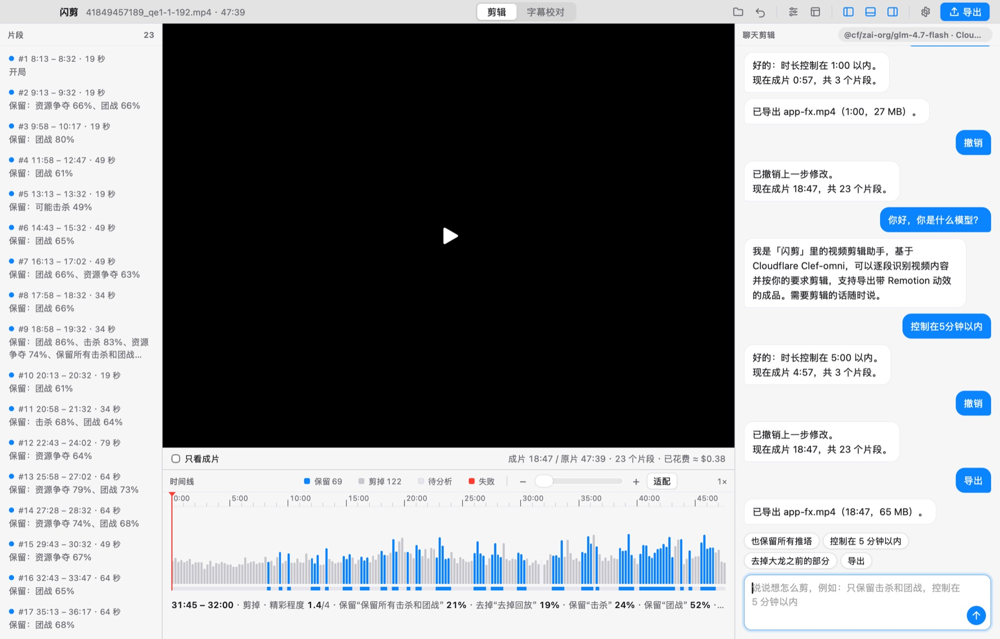

<p align="center"></p>

<h1 align="center">闪剪 FlashCut</h1>

<p align="center">说一句话，剪好一条视频。开源的 macOS AI 视频剪辑应用。<br/>
<a href="https://cut.islumi.com">官网</a> · <a href="https://github.com/coderPerseus/flashcut/releases/latest">下载</a></p>

打开任意视频，告诉闪剪“只保留击杀和团战，控制在 5 分钟以内”。它会逐段看完视频（画面和声音），按要求挑出片段，加上 Remotion 动效并导出。另外还能对照语音或画面校对字幕。



## 功能

- **聊天剪辑**：保留 / 去掉某类内容、改时长、指定时间段、撤销、导出，一句话可以包含多个要求。聊天模型可配置，会调用剪辑工具。
- **剪辑模板**：是非、选择、打分三种题型，每题可设“保留 / 去掉 / 加分 / 动效节点 / 开局 / 结尾”；内置电竞、体育、访谈、Vlog、课程模板，可导入导出。
- **Remotion 动效**：开场标题、节点转场、高能时刻（角标、推近、震屏）、结尾提示、片尾卡片。
- **字幕校对**：SRT / VTT / ASS。Clef-omni 逐条判断，Whisper 或视觉模型取证，小模型给出最小修改，再由 Clef-omni 复核；名字类修改交给人工确认。
- **精细时间线**：缩放到 0.1 秒、框选范围保留或剪掉、按状态过滤。
- **自带模型**：OpenAI 兼容 / Anthropic 协议的任意服务（API 中转站、阿里云百炼、DeepSeek、Ollama…），带连接测试和模型列表。

## 安装

1. 从 [Releases](https://github.com/coderPerseus/flashcut/releases/latest) 下载 `FlashCut-macOS.dmg`，把“闪剪”拖进“应用程序”。安装包未签名，第一次请右键 → 打开；提示“已损坏”时运行 `xattr -dr com.apple.quarantine /Applications/闪剪.app`。
2. 安装 ffmpeg：`brew install ffmpeg`。
3. 连接 Cloudflare：`npm i -g cf && cf auth login`（会被自动检测），或在「设置 → 模型」里填 Account ID 和有 Workers AI 权限的 API Token。
4. 可选：导出动效需要 Node.js 18+（首次使用自动安装渲染引擎）。

## 开发

需要 Go 1.27+（`GOTOOLCHAIN=auto` 会自动下载）、Bun 和 ffmpeg。

```bash
bun install
bun run dev                     # 开发模式
bun run build                   # 打包到 build/
go test ./...                   # 单元测试
node scripts/icon.mjs           # 从 public/logo.svg 生成图标
```

命令行工具（与 App 共用同一套逻辑）：

```bash
go run ./cmd/flashcut -m "只保留击杀和团战" -m "控制在5分钟以内" -o out.mp4 match.mp4
go run ./cmd/subcheck -o fixed.srt video.mp4 subtitles.srt
```

推送 `v*` 标签会由 GitHub Actions 构建通用（Apple 芯片 + Intel）安装包并发布 Release。

### 目录

| 路径 | 内容 |
|---|---|
| `main.go`、`settings.go`、`agent.go`、`subtitles.go` | 桌面端接口（MyGo 绑定） |
| `internal/clef` | Cloudflare Clef / Workers AI 客户端（cf CLI 或 API Token） |
| `internal/editor` | 项目、分段、规则、选段、聊天意图解析 |
| `internal/preset` | 模板与内置模板 |
| `internal/effects` | Remotion 动效（内嵌的 Remotion 项目） |
| `internal/subs` | 字幕解析与校对 |
| `internal/llm` | OpenAI 兼容 / Anthropic / Workers AI 聊天客户端 |
| `src/` | 前端界面 |
| `site/` | 官网 |

## 隐私与费用

视频留在本机；分析时把低清晰度的小片段发给 Cloudflare Workers AI。48 分钟的比赛分析一次约 $0.12，字幕校对约每小时 $0.5。密钥只保存在本机（`~/Library/Application Support/闪剪/settings.json`，权限 0600）。

## 许可

[MIT](LICENSE)。动效使用 [Remotion](https://www.remotion.dev)，其许可对个人和 3 人以内的公司免费，更大的团队商用需购买 Remotion 公司授权。
